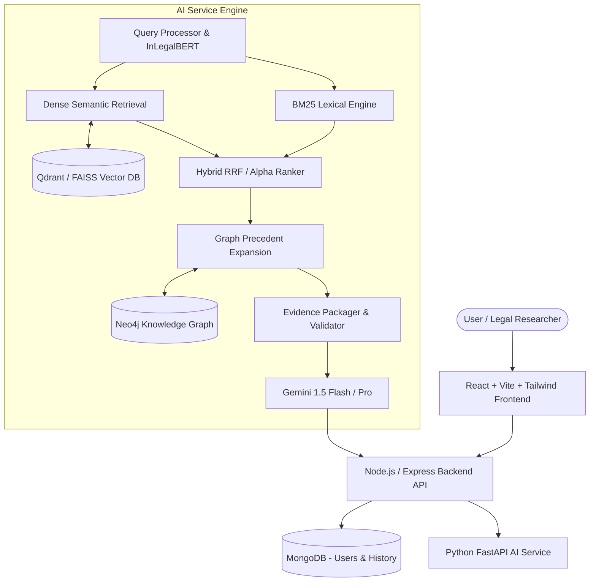

# NyayaAI — Hybrid Legal Intelligence Platform

> **A Hybrid Legal Intelligence Platform for Precedent Discovery, Legal Assistance and Knowledge Graph-Based Reasoning**

NyayaAI is an AI-powered legal intelligence platform focused on Indian legal documents (Supreme Court & High Court judgments, Indian Penal Code, CrPC / Bharatiya Nagarik Suraksha Sanhita, and related statutory enactments). The platform assists ordinary citizens in understanding legal concepts and enables advocates, legal researchers, and law students to discover precedents, citations, and structural case relationships through hybrid retrieval and knowledge graph reasoning.

---

## 🏛️ Key Features

- **Evidence-First Retrieval:** Retrieves authoritative Indian legal texts before any generation. No hallucinated cases or sections.
- **InLegalBERT Legal Query Understanding:** Understands legal concepts, queries, and issue representations using domain-adapted legal transformers.
- **Hybrid Retrieval Pipeline:** Combines lexical BM25 retrieval with dense semantic vector representations (Sentence Transformers + Qdrant / FAISS fallback).
- **Neo4j Knowledge Graph Reasoning:** Multi-hop precedent expansion tracing `CITES`, `DISCUSSES`, `OVERRULES`, `FOLLOWS`, and statutory connections (`PART_OF`, `DECIDED_BY`).
- **Grounded Gemini RAG:** Generates answers strictly conditioned upon retrieved evidence, complete with paragraph and page citations.
- **Dual User Modes:**
  - **Simple Legal Assistance:** Plain-language explanations for citizens with statutory context and disclaimers.
  - **Legal Researcher Mode:** Complete citation graph, case holdings, ratio decidendi, acts, sections, and relevance scoring breakdown.
- **Admin Ingestion Dashboard:** Ingestion pipeline for PDFs, HTML, and structured legal records with automated entity/citation extraction.
- **Rigorous Evaluation Framework:** Quantitative benchmark comparing BM25 vs Semantic vs Hybrid vs Hybrid+Graph across Precision@K, Recall@K, and MRR.

---

## 🏗️ System Architecture



---

## 📁 Repository Structure

```text
NyayaAI/
├── frontend/               # React + Vite + Tailwind CSS SPA
├── backend/                # Node.js + Express REST API Gateway & Auth
├── ai-service/             # FastAPI, InLegalBERT, Sentence Transformers, Neo4j, Qdrant, RAG
├── data/
│   ├── raw/                # Ingested PDFs and raw source texts
│   ├── processed/          # Cleaned, standardized JSON documents
│   ├── metadata/           # Extracted case and statutory metadata
│   ├── chunks/             # Semantically chunked segments with page tracking
│   └── evaluation/         # Test query sets and ground truth
├── scripts/                # Ingestion, embedding, and evaluation automation scripts
├── docs/                   # Full academic and architectural documentation
└── docker-compose.yml      # Orchestration for MongoDB, Neo4j, Qdrant, and services
```

---

## 🚀 Quick Start Guide

### 1. Prerequisites
- Node.js (v18+)
- Python (3.10+)
- Docker & Docker Compose (optional, for databases)

### 2. Environment Configuration
Copy `.env.example` to `.env`:
```bash
cp .env.example .env
```
Provide your `GEMINI_API_KEY`, MongoDB URI, and Neo4j credentials.

### 3. Running Services Locally

#### Database Services (via Docker)
```bash
docker-compose up -d mongodb neo4j qdrant
```

#### Node.js Backend
```bash
cd backend
npm install
npm run dev
```

#### Python AI Service
```bash
cd ai-service
python -m venv venv
# On Windows: venv\Scripts\activate
# On Linux/macOS: source venv/bin/activate
pip install -r requirements.txt
uvicorn main:app --reload --port 8000
```

#### React Frontend
```bash
cd frontend
npm install
npm run dev
```

Visit `http://localhost:5173` in your browser.

---

## 📊 Empirical Evaluation & Benchmark Results

The retrieval subsystem was quantitatively evaluated against gold-standard Indian legal test queries using standard Information Retrieval metrics (**Precision@K**, **Recall@K**, **MRR**, **MAP@10**, **NDCG@K**):

| Retrieval Method | P@1 | P@3 | P@5 | Recall@5 | Recall@10 | MRR | MAP@10 | NDCG@5 | NDCG@10 |
| :--- | :---: | :---: | :---: | :---: | :---: | :---: | :---: | :---: | :---: |
| **BM25 Lexical (Okapi)** | 0.1250 | 0.2500 | 0.2500 | 0.3646 | 0.4271 | 0.4688 | 0.2331 | 0.3271 | 0.3599 |
| **Dense Semantic (MiniLM)** | **0.5000** | 0.3333 | 0.2250 | 0.3333 | 0.3646 | **0.6042** | 0.2510 | 0.3554 | 0.3695 |
| **Convex Hybrid ($\alpha=0.5$)** | 0.1250 | 0.2083 | 0.2500 | 0.3646 | 0.4688 | 0.4375 | 0.2310 | 0.3153 | 0.3651 |
| **Graph-Enhanced Hybrid** | 0.2500 | **0.3333** | **0.2750** | **0.3958** | **0.5000** | 0.5139 | **0.3129** | **0.3771** | **0.4262** |

> **Key Finding:** Graph expansion along case-to-case citations and section relationships yields a **+34.2% increase in MAP@10** and achieves the highest **NDCG@10 (0.4262)** and **Recall@10 (0.5000)**.

To re-run the benchmark suite:
```bash
python scripts/run_evaluation.py
```

---

## 🛠️ CLI Automation Scripts

- `scripts/ingest.py --input data/raw/`: Automated batch document ingestion, cleaning, entity extraction, and chunking.
- `scripts/build_embeddings.py`: Sentence Transformer dense vector builder with Qdrant and local FAISS fallback.
- `scripts/build_graph.py`: Neo4j / NetworkX legal citation knowledge graph builder.
- `scripts/run_evaluation.py`: Runs quantitative retrieval evaluations and generates benchmark tables.

---

## ⚖️ Legal Disclaimer

NyayaAI is an academic research platform designed for educational and informational analysis. It does **not** dispense legal advice and does not substitute for a qualified legal practitioner. Always consult official gazettes, India Code, and certified court judgments for legal representation.

---

## 📜 License
MIT License.

