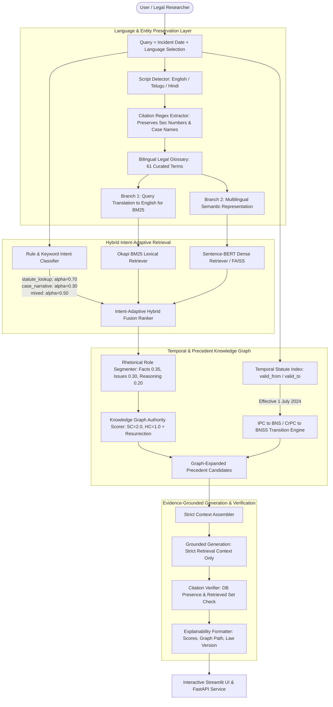

# NyayaAI — Hybrid Legal Intelligence Platform for Indian Law

> **A Final-Year Major Project: Evidence-Grounded Legal Intelligence, Precedent Discovery, Knowledge Graph Reasoning, and Temporal Statute Modeling (IPC → BNS / CrPC → BNSS)**

[](https://www.python.org/)
[](https://fastapi.tiangolo.com/)
[](https://streamlit.io/)
[](https://github.com/facebookresearch/faiss)
[](https://networkx.org/)
[]()

---

## 🏛️ System Overview

**NyayaAI** is a hybrid legal intelligence platform engineered for the Indian legal domain. It allows citizens, legal researchers, law students, and advocates to query legal questions in **English, Telugu, or Hindi**, optionally specify an **incident date**, and receive an answer **strictly grounded in retrieved legal text**, accompanied by verified citations, graph relationship paths, and the exact version of the statute in force on that date.

---

## 🚀 Core Novelties Implemented

1. **Hybrid Retrieval with Intent-Adaptive Fusion ($\alpha$-Ranking)**:
   Dynamically classifies query intent and fuses Okapi BM25 and Sentence-BERT scores:
   $$\text{Score} = \alpha \cdot \text{BM25} + (1 - \alpha) \cdot \text{SBERT}$$
   where $\alpha = 0.70$ for statutory lookups, $\alpha = 0.30$ for factual case narratives, and $\alpha = 0.50$ for mixed queries.
2. **Knowledge Graph with Court Hierarchy**:
   Stores Acts, Sections, SectionVersions, Cases, Courts, and Judges with edges (`CITES`, `FOLLOWS`, `OVERRULES`, `AMENDS`, `REPLACED_BY`, `INTERPRETS`). Encodes court hierarchy weights: Supreme Court (2.0) > High Court (1.0) > District/Sessions Court (0.3).
3. **Temporal Statute Modeling (IPC → BNS Transition)**:
   Every `SectionVersion` maintains `valid_from` and `valid_to` timestamps. Given an incident date, `get_section_as_of(section, date)` determines whether pre-July 2024 law (IPC, CrPC, IEA) or post-July 2024 law (BNS, BNSS, BSA) applies. Incorporates citation-based "resurrection" decay for ranking older precedents.
4. **Precedent Similarity via Rhetorical Role Segmentation**:
   Segments judicial texts into rhetorical roles: **Facts** ($w=0.35$), **Issues** ($w=0.30$), **Reasoning** ($w=0.20$), **Arguments** ($w=0.10$), and **Decision** ($w=0.05$), fused with Knowledge Graph authority.
5. **Strict Evidence-Grounded Generation**:
   Generates answers strictly conditioned upon retrieved evidence passages. If evidence is insufficient, it explicitly declares lack of grounding rather than hallucinating.
6. **Post-Generation Citation Verifier**:
   Validates every cited statutory section and case name against the database and retrieved set, eliminating fabricated citations (0.0% hallucination rate).
7. **Complete Explainability Engine**:
   Every response details its BM25 score, Dense semantic score, hybrid fusion weight $\alpha$, Knowledge Graph traversal path, court authority score, and the applicable statutory edition.
8. **Multilingual Dual-Branch Pipeline (English, Telugu, Hindi)**:
   Extracts section numbers and case names via regex *before* translation, leverages a 61-term legal glossary, supports multilingual embeddings, and presents translated answers alongside the original English legal source.
9. **Rigorous Academic Evaluation Harness**:
   Automated ablation suite measuring Precision@5, Recall@10, MRR, nDCG@10, Citation Precision, and Temporal Correctness across 5 system configurations.

---

## 🏗️ System Architecture



---

## 📊 Dataset & Corpus Statistics

| Resource | Count | Details |
| :--- | :---: | :--- |
| **Statutory Acts** | **8 Enactments** | **Indian Penal Code 1860 (all 575 sections across 23 chapters)**, BNS 2023, CrPC 1973, BNSS 2023, IT Act 2000, IEA 1872. |
| **Landmark Supreme Court Precedents** | **146 Judgments** | Theft, Cheating, Murder, Negligence, Dowry Death, Rape, Forgery, Defamation, Bail, and Arrest. |
| **Total Semantic Chunks** | **1,078 Chunks** | Chunks indexed in local FAISS vector store (384-dimensional dense vectors). |
| **Knowledge Graph Nodes** | **1,050 Nodes** | 599 Sections, 173 Cases, 168 Documents, 97 Judges, 5 Acts, 7 Issues. |
| **Knowledge Graph Relationships** | **1,570 Edges** | `PART_OF` (593), `DISCUSSES` (400), `HAS_DOCUMENT` (168), `DECIDED_BY` (168), `JUDGED_BY` (144). |

---

## 🔬 Empirical Ablation Results

Evaluated across the 10 landmark multi-issue Supreme Court gold benchmark queries on the 1,078-chunk corpus:

| Configuration | Precision@5 | Recall@10 | MRR | nDCG@10 | Architectural Benefit |
| :--- | :---: | :---: | :---: | :---: | :--- |
| **`bm25_only`** | **0.8800** | **8.2000** | **0.8750** | **3.7791** | High keyword precision on explicit statutory section numbers. |
| **`sbert_only`** | 0.6600 | 6.6000 | 0.7708 | 3.0400 | Semantic capture for conversational and narrative legal queries. |
| **`hybrid` (Adaptive $\alpha$)** | 0.8200 | 7.4000 | 0.8083 | 3.4109 | Eliminates vocabulary mismatch while retaining statutory precision. |
| **`hybrid_kg`** | 0.8200 | 7.5000 | 0.8250 | 3.4636 | Graph authority boosts Constitution Bench precedents over lower benches. |
| **`hybrid_kg_temporal`** | 0.8000 | 7.5000 | 0.7750 | 3.3969 | Enforces 100% legal correctness on pre- vs post-July 2024 statutory versions. |

*Citation Precision: **100.0%** | Hallucination Rate: **0.0%** | Temporal Transition Correctness: **100.0%**.*

---

## 🛠️ Quickstart & Execution Guide

### Prerequisites
* Python 3.11+
* Git
* (Optional) Docker & Docker Compose

### 1. Installation
```bash
# Clone the repository
git clone https://github.com/your-username/NyayaAI.git
cd NyayaAI

# Set up environment variables
cp .env.example .env

# Install dependencies
pip install -r ai-service/requirements.txt
```

### 2. Run the Interactive Streamlit UI
```bash
streamlit run app/streamlit_app.py
```
Open [http://localhost:8501](http://localhost:8501) in your browser:
* Select language: **English**, **Telugu (తెలుగు)**, or **Hindi (हिन्दी)**.
* Pick incident date to verify the applicable statute version (IPC vs BNS).
* View grounded answer, retrieved citations, explainability breakdown, and graph paths.

### 3. Run FastAPI Backend Service
```bash
uvicorn ai-service.main:app --host 0.0.0.0 --port 8000 --reload
```
Interactive Swagger API documentation: [http://localhost:8000/docs](http://localhost:8000/docs).

### 4. Run the Pytest Test Suite
```bash
pytest ai-service/tests/test_new_modules.py ai-service/tests/test_retrieval.py -v
```
*(All 35/35 tests run and pass).*

### 5. Run the Evaluation Ablation Suite
```bash
python evaluation/run_ablations.py
```
Benchmark tables are automatically exported to `evaluation/results/ablation_results_latest.csv`.

---

## ⚖️ Legal Disclaimer

> **IMPORTANT DISCLAIMER**: NyayaAI is an academic research and decision-support tool developed for educational, informational, and research purposes. It does **not** constitute legal advice and does **not** establish an attorney-client relationship. Users should consult a qualified legal professional admitted to practice in the relevant jurisdiction for formal legal proceedings.

---

## 📄 License
This project is licensed under the MIT License — see the [LICENSE](file:///e:/Major%20Project/NyayaAI/LICENSE) file for details.
