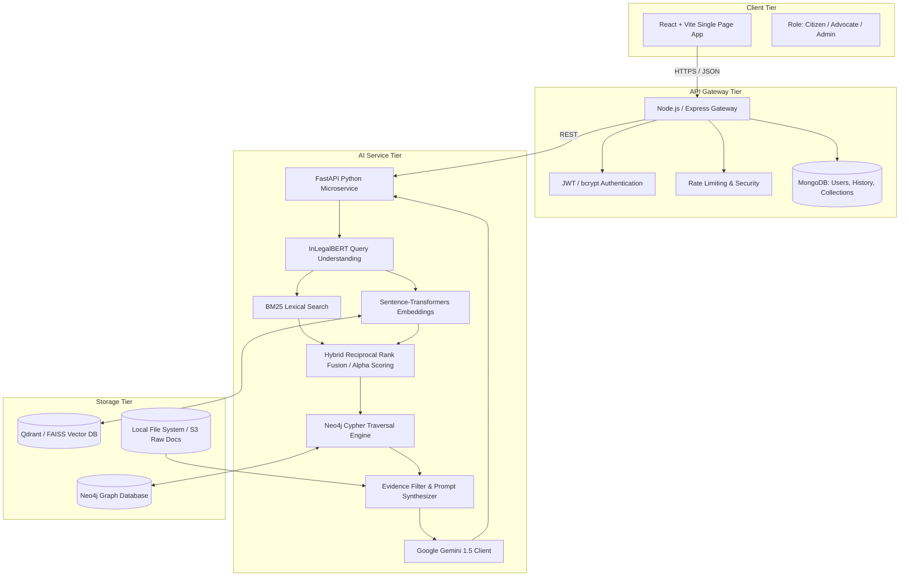
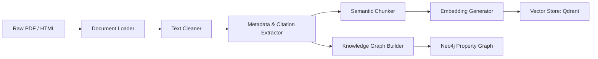

# NyayaAI Architecture Specification

## 1. System Overview

NyayaAI is an academic and enterprise-grade legal intelligence platform tailored for the Indian judicial ecosystem. Its primary design paradigm is **Retrieval-First, Evidence-Grounded Reasoning**.

Unlike generic LLM wrappers, NyayaAI strictly isolates factual retrieval from generation:
1. Lexical retrieval captures exact statutory sections, case citations, and judicial keywords.
2. Dense semantic retrieval captures conceptual equivalents and query paraphrases.
3. Graph expansion discovers precedent lineages (`CITES`, `OVERRULES`, `FOLLOWS`) and statutory relationships (`DISCUSSES`, `PART_OF`).
4. Generative synthesis is performed by Gemini *strictly constrained* to the validated context package.

---

## 2. Ingestion & Document Processing Pipeline

Raw Indian legal documents (Supreme Court Judgments, High Court Judgments, Central Acts from India Code) pass through modular stages:

1. **Document Loader (`document_loader.py`):** Multi-format parser handling PDF text streams (preserving page breaks), HTML, and JSON.
2. **Text Cleaner (`text_cleaner.py`):** Normalizes Indian legal typography, cleans headers/footers, watermark artifacts, court stamp artifacts, and hyphenations.
3. **Metadata Extractor (`metadata_extractor.py`):** Extracts Case Name, Court, Bench/Judges, Date of Judgment, Act names, Section numbers, and citation strings (e.g., `(2020) 5 SCC 123`, `AIR 2020 SC 123`).
4. **Citation & Entity Extractor (`citation_extractor.py`, `legal_entity_extractor.py`):** Extracts inter-case citations, statute mentions, and legal issues.
5. **Semantic Chunker (`chunker.py`):** Chunks text using paragraph and statutory heading boundaries (500–1000 tokens) with configurable overlap, attaching full page provenance to every chunk.
6. **Vector & Graph Storage:** Chunks are vectorized and indexed in Qdrant (or FAISS fallback); relational entities and edges are populated in Neo4j.

---

## 3. Retrieval Strategy

The system evaluates four distinct retrieval modes:
- **BM25 Lexical Retrieval:** $Score_{BM25}(D, Q) = \sum_{i=1}^{N} IDF(q_i) \cdot \frac{f(q_i, D) \cdot (k_1 + 1)}{f(q_i, D) + k_1 \cdot (1 - b + b \cdot \frac{|D|}{avgdl})}$
- **Dense Semantic Retrieval:** Cosine similarity of sentence-transformer embeddings.
- **Hybrid Retrieval:** Weighted linear fusion or Reciprocal Rank Fusion:
  $$Score_{Hybrid} = \alpha \cdot Normalized(Score_{BM25}) + (1 - \alpha) \cdot Normalized(Score_{Semantic})$$
- **Knowledge-Graph Enhanced Retrieval:** Expands top hybrid candidates via Neo4j 1-hop and 2-hop edges (`CITES`, `DISCUSSES`, `OVERRULES`), injecting precedent context into ranking and RAG generation.

---

## 4. Grounded Generation (RAG)

The context delivered to Gemini contains:
- Exact Case Names and Dates
- Extracted statutory text for referenced Sections
- Verbatim text excerpts with Page Number & Paragraph citations
- Graph lineage explaining why cited cases are authoritative

If evidence is missing or confidence is beneath threshold $\tau$, the system generates:
> *"Insufficient reliable evidence was retrieved from the authoritative legal sources to answer this question confidently."*
