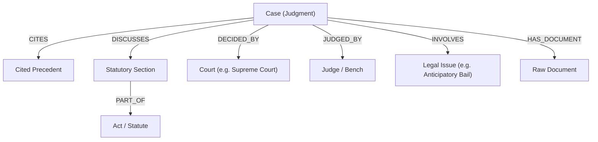

# NyayaAI Legal Knowledge Graph Architecture

## 1. Overview

The **NyayaAI Knowledge Graph** captures ontological and citation relationships connecting statutory Acts, Sections, Courts, Judges, Landmark Precedents, and Legal Issues.

---

## 2. Ontology & Schema

### Node Labels
| Node Label | Key Attributes |
|---|---|
| `Case` | `case_id`, `name`, `court`, `judgment_date`, `case_number`, `legal_domain`, `source_url` |
| `Act` | `act_id`, `name`, `year`, `legal_domain`, `source_url` |
| `Section` | `id`, `section_number`, `title`, `text`, `act_name` |
| `Court` | `id`, `name` |
| `Judge` | `id`, `name` |
| `LegalIssue`| `id`, `name` |
| `Document` | `document_id`, `sha256`, `total_pages` |

### Relationship Types

---

## 3. Dual-Engine Architecture

1. **Neo4j Enterprise / Community Graph Database**:
   - Bolt protocol connection (`bolt://localhost:7687`).
   - Unique constraints on `Case(id)`, `Act(id)`, `Section(id)`.
   - Cypher query traversal.
2. **NetworkX + JSON Local Fallback**:
   - Zero-dependency local graph engine persisted to `data/knowledge_graph/graph_nodes.json` and `data/knowledge_graph/graph_edges.json`.
   - Breadth-First-Search (BFS) traversal supporting configurable expansion depth (1 to 2).

---

## 4. Graph-Enhanced Hybrid Retrieval Flow

When a user query is executed:
1. **InLegalBERT** classifies the query and extracts statutory references.
2. **Hybrid Retrieval (BM25 + Dense Vectors)** identifies the top seed cases.
3. **Knowledge Graph Expansion** discovers:
   - Historical precedents cited by the seed cases (`CITES`)
   - Applicable statutory provisions (`DISCUSSES`)
   - Shared legal issues (`INVOLVES`)
4. **Relational Evidence Boosting** prioritizes candidates exhibiting strong graph connectivity.
5. Produces relational triples for UI visualization and RAG context grounding.
